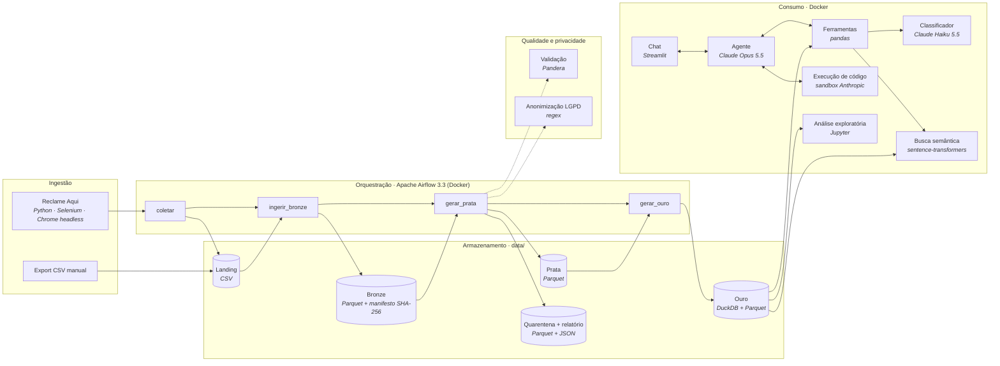
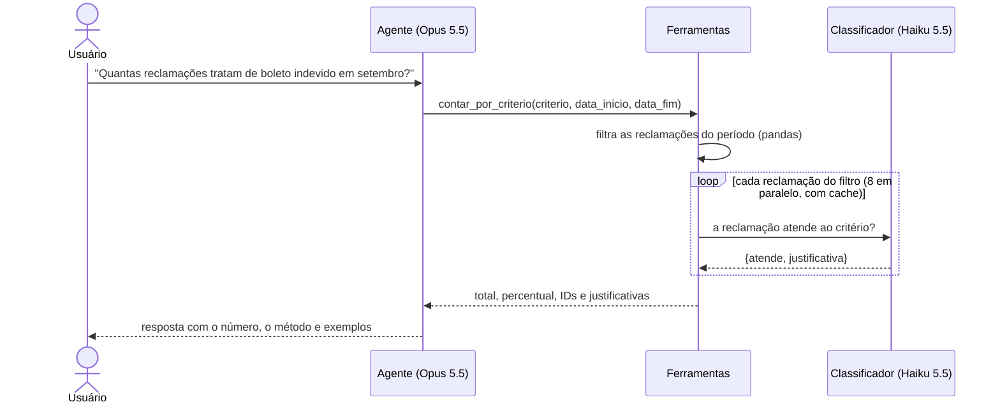

# Agente Reclame Aqui Localiza Meoo

Pipeline de dados e agente analítico para reclamações de clientes da Localiza publicadas no Reclame Aqui.

## Sumário

1. [Problema](#1-problema)
2. [Fontes de dados](#2-fontes-de-dados)
3. [Arquitetura](#3-arquitetura)
4. [Stack escolhida e justificativa](#4-stack-escolhida-e-justificativa)
5. [Decisões técnicas](#5-decisões-técnicas)
6. [Dicionário de dados](#6-dicionário-de-dados)
7. [Escopo](#7-escopo)
8. [Riscos e plano B](#8-riscos-e-plano-b)
9. [Prova de acesso à fonte](#9-prova-de-acesso-à-fonte)

---

## 1. Problema

> **Disciplinas aplicadas:**
>
> - **Projetos de Engenharia de Dados** (principal): a seção define o público, a dor e a decisão que os dados apoiam, o ponto de partida de um projeto de dados.
> - **Análise de Dados**: o problema é formulado como perguntas analíticas (contagens, rankings, tendências por período e local) que orientam decisões.

**Para quem:** a equipe de experiência do cliente (CX) e ouvidoria de uma locadora de veículos, aqui a Localiza, que acompanha a reputação da empresa no Reclame Aqui.

**A dor:** as reclamações chegam como texto livre, todos os dias. Hoje, responder perguntas simples exige ler reclamação por reclamação ou montar planilhas à mão. Por exemplo:

- "quantas reclamações de cobrança indevida tivemos nas últimas 3 semanas?"
- "em que estados o problema de carro reserva está concentrado?"

Com isso, a resposta chega tarde e depende de quem fez a leitura.

**A decisão que os dados apoiam:** **onde priorizar ações corretivas**. Ou seja, que tipo de problema atacar primeiro, em quais estados e cidades, e se uma ação já tomada reduziu as reclamações.

Exemplos de decisões:

- reforçar o processo de cobrança se as reclamações de "boleto indevido" crescerem semana a semana;
- direcionar a auditoria de manutenção para as UFs com mais casos de "carro entregue com defeito";
- acionar o jurídico quando aparecerem casos com risco de processo.

**Como o projeto resolve:** um pipeline diário mantém uma base limpa, validada e anonimizada. Sobre ela, um agente responde perguntas com **números verificáveis**:

- cada contagem vem de código (pandas e DuckDB), nunca de estimativa do modelo de linguagem;
- cada resposta traz os IDs das reclamações usadas, para conferência.

## 2. Fontes de dados

> **Disciplinas aplicadas:**
>
> - **Web Mining & Crawler Scraping** (principal): a fonte é um site público, e o acesso aos dados é feito por raspagem das páginas com navegador automatizado.
> - **Introdução ao Processamento de Dados**: a fonte é caracterizada por formato, volume, crescimento estimado e frequência de atualização.

| Item                      | Descrição                                                                                                                                                                                                                                                                                                                                                                                                  |
| ------------------------- | ------------------------------------------------------------------------------------------------------------------------------------------------------------------------------------------------------------------------------------------------------------------------------------------------------------------------------------------------------------------------------------------------------------ |
| **Origem**          | Reclamações públicas da Localiza no Reclame Aqui (reclameaqui.com.br)                                                                                                                                                                                                                                                                                                                                     |
| **Formato**         | CSV com 6 colunas: `titulo`, `ID`, `Data`, `Cidade`, `Estado`, `Texto_Reclamacao` (seção 6). O coletor abre as páginas num navegador automatizado, extrai o texto e grava no mesmo formato                                                                                                                                                                                                    |
| **Volume atual**    | 99 reclamações de 28/08/2026 a 26/09/2026: 195 KB de CSV, 28,6 mil palavras, 18 UFs e 51 cidades                                                                                                                                                                                                                                                                                                           |
| **Volume estimado** | No ritmo observado (~3,3 por dia): ~100 por mês e ~1.200 por ano (≈ 2,4 MB de CSV por ano). O volume real da empresa no site pode ser maior. A arquitetura foi pensada para crescer (seção 8)                                                                                                                                                                                                            |
| **Frequência**     | DAG diário às 06:00 (`0 6 * * *`). As reclamações são publicadas continuamente, então um ciclo diário basta para apoiar decisões semanais                                                                                                                                                                                                                                                          |
| **Acesso**          | Dois caminhos, que chegam ao mesmo ponto (a pasta `data/landing/`): **(a) scraping** das páginas públicas das reclamações respondidas, com Selenium e Chrome headless ([reclameaqui_scraper.py](../reclameaqui_scraper.py)), que também guarda o texto bruto de cada página em `data/bruto/`; **(b) arquivo CSV** exportado e colocado na landing. A carga atual veio do caminho (b).  |

## 3. Arquitetura

> **Disciplinas aplicadas:**
>
> - **Arquitetura de Sistemas de Big Data** (principal): o sistema é organizado em camadas (landing, bronze, prata e ouro), com orquestração, armazenamento e consumo separados.
> - **Processamento de Linguagem Natural**: o agente (3.4) responde perguntas em linguagem natural e um modelo de linguagem classifica cada reclamação por assunto.
> - **Machine Learning para Engenharia de Dados**: a busca semântica (3.4) usa embeddings de um modelo pré-treinado, gerados e versionados junto com os dados.

O projeto tem duas partes que se comunicam só pelos dados:

1. **Pipeline de dados** (orquestrado pelo Airflow): coleta as reclamações e as leva até uma tabela pronta para consumo, passando por camadas bronze, prata e ouro.
2. **Agente analítico** (app Streamlit): responde perguntas em linguagem natural sobre a camada ouro, usando o Claude com ferramentas de consulta.

### 3.1 Visão geral



| Camada          | Tecnologia                                          | Responsabilidade                                                   |
| --------------- | --------------------------------------------------- | ------------------------------------------------------------------ |
| Ingestão       | Python (Selenium + Chrome headless) + pasta landing | Trazer o dado bruto, sem transformar                               |
| Bronze          | Parquet + manifesto JSON                            | Cópia fiel e rastreável; carga incremental pelo hash do arquivo  |
| Prata           | pandas + Pandera + regex                            | Padronizar, deduplicar, validar, separar a quarentena e anonimizar |
| Ouro            | DuckDB + Parquet                                    | Tabelas de consumo, série diária e histórico de execuções     |
| Orquestração  | Apache Airflow 3.3                                  | Agendamento, novas tentativas, dependências e histórico          |
| Consumo         | Streamlit + Claude (Anthropic API)                  | Perguntas em linguagem natural com respostas auditáveis           |
| Observabilidade | JSONL de telemetria + relatórios de qualidade      | Custo, tokens e latência por chamada; qualidade por lote          |

### 3.2 Camadas de dados

| Camada     | Onde                                            | O que contém                                                                       | Regra principal                                                                   |
| ---------- | ----------------------------------------------- | ----------------------------------------------------------------------------------- | --------------------------------------------------------------------------------- |
| Landing    | `data/landing/*.csv`                          | Arquivos como chegaram (do coletor ou exportados à mão)                           | Ninguém altera; só se acrescentam arquivos                                      |
| Bronze     | `data/bronze/reclamacoes/*.parquet`           | Cópia fiel, tudo como texto, mais origem, hash e data de ingestão                 | Incremental e idempotente: cada arquivo entra uma vez (hash SHA-256 no manifesto) |
| Prata      | `data/prata/reclamacoes.parquet`              | Dados padronizados, tipados, deduplicados, validados e anonimizados                 | Só é substituída se o lote passar nas regras de qualidade                      |
| Quarentena | `data/quarentena/*.parquet`                   | Linhas reprovadas, com a coluna `_motivos`                                        | Auditoria: nada é descartado em silêncio                                        |
| Ouro       | `data/ouro/reclamacoes.duckdb` e `.parquet` | Tabela de consumo com colunas derivadas, série diária e histórico de execuções | Troca atômica: leitores nunca veem dados pela metade                             |

As colunas de cada camada estão na seção 6.

### 3.3 Pipeline

As funções ficam em [pipeline/](../pipeline/) e não dependem do Airflow. O DAG em [dags/reclamacoes_dag.py](../dags/reclamacoes_dag.py) só as encadeia, e o mesmo fluxo roda pela linha de comando com `python -m pipeline.executar`. Assim os testes cobrem a lógica sem precisar subir o Airflow.

| Tarefa             | Módulo                                                                                                                 | O que faz                                                                                                                                                                                  | Quando falha                                                                                                                                            |
| ------------------ | ----------------------------------------------------------------------------------------------------------------------- | ------------------------------------------------------------------------------------------------------------------------------------------------------------------------------------------ | ------------------------------------------------------------------------------------------------------------------------------------------------------- |
| `coletar`        | [coleta.py](../pipeline/coleta.py) → [reclameaqui_scraper.py](../reclameaqui_scraper.py)                                 | Percorre `RA_MAX_PAGINAS` páginas da lista de reclamações respondidas, extrai o texto de cada uma e grava na landing um CSV só com IDs novos (o JSON bruto vai para `data/bruto/`) | Nunca derruba o DAG. Qualquer erro (Chrome ausente, site fora do ar, bloqueio) vira o status `erro` e o pipeline segue com o que já está na landing |
| `ingerir_bronze` | [bronze.py](../pipeline/bronze.py)                                                                                       | Converte para Parquet os CSVs ainda não vistos                                                                                                                                            | Arquivo sem as colunas obrigatórias                                                                                                                    |
| `gerar_prata`    | [prata.py](../pipeline/prata.py), [qualidade.py](../pipeline/qualidade.py), [anonimizacao.py](../pipeline/anonimizacao.py) | Padroniza, deduplica (vale a versão mais recente de cada ID), valida, separa a quarentena e mascara dados pessoais                                                                        | Quarentena acima de `LIMITE_QUARENTENA_PCT` (padrão 10%) ou nenhuma linha válida                                                                    |
| `gerar_ouro`     | [ouro.py](../pipeline/ouro.py)                                                                                           | Cria as tabelas de consumo no DuckDB e exporta o Parquet usado pelo app                                                                                                                    | Erro de escrita                                                                                                                                         |

#### Qualidade dos dados

As regras de linha são declaradas com Pandera em [qualidade.py](../pipeline/qualidade.py):

- `ID` numérico;
- `Data` válida, entre 2000 e hoje;
- `Estado` entre as 27 UFs;
- `Cidade`, `titulo` e `Texto_Reclamacao` não vazios (com tamanho mínimo).

Cada execução grava um relatório em `data/qualidade/relatorio_<execução>.json` com: linhas lidas, duplicadas removidas, motivos de quarentena, dados pessoais mascarados por tipo e o status do lote. O relatório é gravado mesmo quando o lote é reprovado.

#### Anonimização (LGPD)

As reclamações são públicas, mas trazem placas, CPFs, telefones, e-mails e números de contrato. Esses dados não ajudam nas análises, então são trocados por marcadores (`[PLACA]`, `[CPF]` etc.) na prata, antes de chegarem ao agente e à API externa. Os padrões foram ajustados olhando os dados reais: números de protocolo com 11 dígitos não são tratados como CPF, e contratos no formato `GVM9503/25` ganham marcador próprio.

### 3.4 Agente

| Componente         | Arquivo                            | Papel                                                                                                     |
| ------------------ | ---------------------------------- | --------------------------------------------------------------------------------------------------------- |
| Interface          | [app.py](../app.py)                 | Chat em Streamlit. Recarrega dados e índice quando a camada ouro muda, e mostra o custo de cada resposta |
| Loop do agente     | [agente.py](../agente.py)           | Envia a pergunta ao Claude, executa as ferramentas pedidas e devolve os resultados até a resposta final  |
| Ferramentas        | [ferramentas.py](../ferramentas.py) | `contar_reclamacoes`, `contar_por_criterio`, `buscar_reclamacoes`, `obter_reclamacao`             |
| Índice semântico | [dados.py](../dados.py)             | Embeddings locais (`paraphrase-multilingual-mpnet-base-v2`) dos trechos de cada reclamação            |
| Telemetria         | [telemetria.py](../telemetria.py)   | Registra tokens, custo estimado e duração de cada chamada em `data/logs/`                             |

#### Como uma pergunta é respondida



O modelo escolhe a ferramenta, mas **os números vêm sempre de código determinístico**:

- contagens, rankings e médias saem do pandas;
- contagens por assunto saem da soma das decisões do classificador, uma por reclamação;
- cálculos fora do escopo das ferramentas vão para a execução de código.

O modelo só redige a resposta.

### 3.5 Infraestrutura

`docker compose up --build` sobe três serviços que compartilham a pasta `data/`. O `airflow` e o `app` só iniciam depois que o `pipeline` termina, então o app já abre com a camada ouro pronta e os dois nunca gravam nas camadas ao mesmo tempo que ele.

| Serviço     | Imagem                                                                                                                      | Porta |
| ------------ | --------------------------------------------------------------------------------------------------------------------------- | ----- |
| `pipeline` | A mesma do `airflow`. Roda `python -m pipeline.executar` uma vez (coleta → ouro) e termina                             | —    |
| `airflow`  | `apache/airflow:3.3.2-python3.12` + Chromium + dependências do pipeline, em modo `standalone`. O DAG já começa ativo | 8080  |
| `app`      | `python:3.12-slim` + torch só-CPU + dependências do agente                                                              | 8501  |

## 4. Stack escolhida e justificativa

> **Disciplinas aplicadas:**
>
> - **Big Data e Tecnologias de Armazenamento** (principal): a escolha central da stack é a de formatos e motores de armazenamento (Parquet colunar e DuckDB), comparados com as alternativas.
> - **Linguagens de Programação para Engenharia de Dados**: todo o pipeline e o agente são escritos em Python (pandas, Pandera, Selenium), com SQL no DuckDB.
> - **Processamento de Linguagem Natural**: a stack inclui os modelos de linguagem (Claude Opus e Haiku) e o modelo de embeddings multilíngue (sentence-transformers).

| Bloco                    | Escolha                                                     | Alternativas consideradas              | Por que esta                                                                                                                                                                                                                                                                                                                                                                                |
| ------------------------ | ----------------------------------------------------------- | -------------------------------------- | ------------------------------------------------------------------------------------------------------------------------------------------------------------------------------------------------------------------------------------------------------------------------------------------------------------------------------------------------------------------------------------------- |
| Orquestração           | **Apache Airflow 3.3**                                | Prefect, Dagster, cron                 | É o padrão de mercado em engenharia de dados, com histórico, retries e interface prontos. Prefect seria mais leve e Dagster modela melhor os "assets", mas o Airflow é o que mais aparece em vagas e ambientes corporativos. O cron não dá visibilidade nem retries. As funções do pipeline não dependem do Airflow, então trocar de orquestrador não exige reescrever a lógica |
| Formato das camadas      | **Parquet**                                           | CSV, JSON                              | É colunar, comprimido e mantém os tipos. É o formato de fato de data lakes, e é lido nativamente por pandas, DuckDB, Spark e Athena, o que deixa o caminho para a nuvem aberto. CSV perde tipos e é ambíguo com textos de várias linhas                                                                                                                                              |
| Banco analítico         | **DuckDB**                                            | PostgreSQL, SQLite                     | Faz SQL analítico (colunar) num arquivo, sem servidor para operar, o que é adequado ao volume atual. Lê Parquet e S3 diretamente. O PostgreSQL exigiria um serviço para poucos MB de dados. O SQLite é orientado a transações, não a análise                                                                                                                                       |
| Qualidade                | **Pandera**                                           | Great Expectations, validação manual | Regras declarativas em Python, no mesmo DataFrame do pipeline, com relatório de cada falha por linha. O Great Expectations é mais completo, mas pede muito mais configuração (contextos, suítes, checkpoints) para o tamanho do projeto. Validação manual não documenta as regras                                                                                                   |
| Anonimização           | **Expressões regulares**                             | NER (spaCy, Presidio)                  | Placas, CPF, telefones e contratos têm formato fixo, que a regex pega com precisão e sem custo, e os padrões foram ajustados com os dados reais. Nomes de pessoas exigiriam NER, que fica como incremento (seção 7)                                                                                                                                                                    |
| Agente                   | **Claude Opus 5.5** (Anthropic API)                   | GPT, Gemini, modelos locais            | Uso de ferramentas confiável, raciocínio adaptativo, cache de prompt e execução de código integrada. Modelos locais não dariam conta do uso de ferramentas em várias etapas com a mesma qualidade, num computador comum                                                                                                                                                              |
| Classificação em massa | **Claude Haiku 5.5**                                  | Opus para tudo, classificador treinado | Custa 40 vezes menos que o Opus por token, o suficiente para uma decisão sim/não por reclamação (menos de 1 centavo para 100). Um classificador treinado exigiria dados rotulados, que não existem                                                                                                                                                                                     |
| Embeddings               | **sentence-transformers** (modelo multilíngue local) | API de embeddings                      | Grátis, roda offline, entende português, e o texto não sai da máquina para gerar os vetores                                                                                                                                                                                                                                                                                             |
| Interface                | **Streamlit**                                         | Dash, front-end próprio               | Um chat completo com pouco código Python. O foco do trabalho são os dados, não o front-end                                                                                                                                                                                                                                                                                               |
| Empacotamento            | **Docker Compose**                                    | Instalação manual                    | O ambiente se reproduz com um comando e tem versões fixas, e os mesmos containers servem de base para a nuvem                                                                                                                                                                                                                                                                              |
| Testes                   | **pytest**                                            | unittest                               | Fixtures e parametrização deixam os testes curtos. É o padrão em Python                                                                                                                                                                                                                                                                                                                 |

## 5. Decisões técnicas

> **Disciplinas aplicadas:**
>
> - **DataOps** (principal): as decisões tratam de carga incremental e idempotente, orquestração, qualidade automatizada, testes e avaliação contínua do pipeline.
> - **Web Mining & Crawler Scraping**: a seção 5.5 descreve o coletor com navegador automatizado, as pausas, as novas tentativas e a extração dos campos do texto da página.
> - **Governança de Dados**: a seção 5.6 trata da anonimização exigida pela LGPD, acessos restritos aos dados originais e processode quarentena.
> - **Processamento de Linguagem Natural**: as seções 5.7 a 5.9 tratam da classificação de textos por um modelo de linguagem, do índice semântico e da avaliação com modelo juiz.

Cada decisão traz o contexto, a escolha e o que se perde com ela.

### 5.1 Arquitetura em camadas (bronze, prata, ouro)

**Contexto.** Os dados vêm de fontes diferentes (coletor e exports manuais) e podem chegar repetidos, incompletos ou com erros.

**Decisão.** Separar em camadas com responsabilidades fixas: a bronze guarda o dado como chegou, a prata limpa e valida, a ouro serve o consumo.

**Consequências.** Qualquer resultado pode ser rastreado até o arquivo de origem (`_arquivo_origem`, `_hash_arquivo`), e a prata e a ouro podem ser recriadas do zero a partir da bronze. Em troca, os dados ocupam mais espaço em disco, o que é irrelevante no volume atual.

### 5.2 Carga incremental na bronze; recálculo completo na prata e na ouro

**Contexto.** Reprocessar o mesmo arquivo duplicaria dados. Por outro lado, um upsert incremental na prata exigiria um controle de versões mais complexo.

**Decisão.** A bronze é incremental pelo hash do conteúdo de cada arquivo. A prata e a ouro são recalculadas a partir de toda a bronze a cada execução.

**Consequências.** O pipeline é idempotente (rodar duas vezes dá o mesmo resultado), e uma correção nas regras se aplica a todo o histórico. O custo do recálculo cresce com o volume: com centenas de milhares de linhas, valeria passar a prata para um merge incremental, por exemplo um `MERGE` no DuckDB por `ID`.

### 5.3 Parquet e DuckDB em vez de um banco servidor

**Contexto.** O volume é pequeno e o projeto precisa rodar numa máquina só.

**Decisão.** Parquet nas camadas e DuckDB na ouro (SQL analítico num arquivo, sem servidor). O app lê o Parquet da ouro, e o DuckDB fica para análises em SQL e para o histórico de execuções.

**Consequências.** Nenhum serviço extra para operar. A escrita é atômica (arquivo temporário seguido de troca), então o app nunca lê uma versão pela metade. O DuckDB aceita um único processo escrevendo por vez: o `max_active_runs=1` do DAG garante isso entre execuções do Airflow, e no Docker o Airflow só sobe depois que o serviço `pipeline` termina.

### 5.4 Airflow como orquestrador

**Contexto.** O pipeline precisa de agendamento, novas tentativas em caso de falha, histórico de execuções e uma interface de acompanhamento.

**Decisão.** Airflow 3.3, com DAG em TaskFlow (`airflow.sdk`), rodando em modo `standalone` no Docker. As funções do pipeline não importam nada do Airflow.

**Consequências.** Airflow é o padrão de mercado e mostra a linhagem das tarefas na interface. O modo `standalone` (SQLite, um processo só) serve para desenvolvimento, mas não para produção; lá seriam necessários Postgres e scheduler e api-server em processos separados. Como o pipeline não depende do Airflow, ele roda e é testado sem o orquestrador.

### 5.5 Coleta com navegador automatizado e coleta opcional

**Contexto.** O site usa proteção anti-bot. Um primeiro coletor, baseado em requisições HTTP diretas (`requests`), recebeu erros na listagem de reclamações (seção 9.6). Os termos de uso do Reclame Aqui restringem a coleta automatizada por bots ou qualquer tipo de automação.

**Decisão.** Criar um novo coletor oficial. O [reclameaqui_scraper.py](../reclameaqui_scraper.py) usa Selenium com Chrome headless:

- lê a lista de reclamações **respondidas** (`status=ANSWERED`) e abre cada reclamação num navegador novo;
- se apresenta com o User-Agent de um Chrome comum e desativa o sinal de automação do navegador (`AutomationControlled`);
- espera de 4 a 7,5 s (sorteados de forma uniformemente aleatória) entre uma reclamação e outra, e faz até 3 tentativas por página quando cai na verificação anti-bot ou estoura o tempo de carregamento (60 s);
- extrai os campos do texto da página (ID, data, cidade/UF e o relato a partir de "O que aconteceu");
- pula IDs que já estão na prata, sem encerrar a coleta: uma reclamação respondida depois aparece no meio das antigas.

Uma falha não derruba o pipeline, que segue com os CSVs da landing. A coleta pode ser desligada com `RA_COLETA_ATIVA=false`.

Optou-se pelo segundo coletor porque o primeiro enfrentou problemas na raspagem dos dados por conta das barreiras de verificação do Cloudflare.

**Justificativa da coleta.** A coleta foi feita apesar da restrição dos termos de uso, pelos motivos abaixo:

- **Finalidade acadêmica:** os dados são usados só neste trabalho de conclusão de curso, sem fins comerciais e sem redistribuição da base coletada.
- **Dados públicos:** as reclamações coletadas são publicadas abertamente no site e podem ser lidas por qualquer visitante, sem login ou cadastro. O coletor lê apenas o que um visitante comum vê; não acessa áreas restritas nem dados de conta.

Além disso, a coleta tem volume baixo, com pausas entre as páginas, e os dados pessoais são mascarados na prata antes de qualquer análise (seção 5.6). Essa justificativa não substitui uma autorização formal do Reclame Aqui: para qualquer uso além do acadêmico, seria necessário obtê-la.

**Consequências.** A coleta é lenta (cerca de 15 s por reclamação, por abrir um navegador por página) e depende do layout do site: XPaths da lista e do botão de paginação e os rótulos do texto. A imagem do Airflow passa a incluir o Chromium. O texto bruto de cada coleta fica em `data/bruto/`, o que permite refazer a limpeza sem acessar o site de novo. Para o restante do pipeline, o que importa continua sendo o contrato de entrada: qualquer arquivo no formato da landing é processado do mesmo jeito.

### 5.6 Anonimização na prata

**Contexto.** Os textos têm placas, CPFs, telefones, e-mails e contratos. Esses dados seriam enviados à API do modelo e apareceriam nas respostas.

**Decisão.** Mascarar com expressões regulares na prata, antes de qualquer consumo. A bronze guarda o original, para auditoria.

**Consequências.** Os dados pessoais não chegam ao agente nem à API externa. Expressões regulares não pegam nomes de pessoas; para isso seria preciso um modelo de reconhecimento de entidades (NER), o que fica como trabalho futuro. A bronze contém dados pessoais e deve ter o acesso restrito.

### 5.7 Números vêm de código, não do modelo

**Contexto.** Modelos de linguagem erram contas e contagens quando estimam lendo textos.

**Decisão.** Toda resposta quantitativa sai de uma ferramenta determinística: pandas para contagens e estatísticas, e a execução de código para cálculos livres. Contagens por assunto usam um classificador que decide reclamação por reclamação, em vez de contar os resultados de uma busca.

**Consequências.** Os números são exatos e auditáveis: as ferramentas devolvem os IDs e as justificativas. Contar por assunto custa uma chamada ao Haiku por reclamação (menos de 1 centavo para 100 reclamações) e leva de 20 a 30 s na primeira vez; repetições usam o cache.

### 5.8 Índice semântico gerado pelo app, fora do Airflow

**Contexto.** Os embeddings precisam do torch (~800 MB), o que deixaria a imagem do Airflow pesada.

**Decisão.** O app gera o índice quando a camada ouro muda. O cache é identificado por uma assinatura do modelo, do fatiamento e do texto de cada trecho.

**Consequências.** A imagem do Airflow fica sem o torch (ela já carrega o Chromium do coletor). A primeira pergunta depois de uma atualização dos dados demora mais, enquanto o índice é gerado (cerca de 1 minuto para 100 reclamações em CPU).

### 5.9 Avaliação com gabarito calculado dos dados

**Contexto.** Sem um baseline, não dá para saber se uma mudança no prompt ou nas ferramentas melhorou ou piorou o agente.

**Decisão.** Um conjunto fixo de perguntas em [avaliacao/casos.py](../avaliacao/casos.py). O gabarito de cada uma é calculado direto dos dados com pandas, sem usar as ferramentas do agente, para a avaliação não ser circular. A correção é automática:

- números com tolerância;
- ordem de rankings;
- IDs inventados;
- uso da ferramenta certa;
- um modelo juiz para as perguntas abertas.

**Consequências.** Mudanças podem ser comparadas com números. O modelo não é determinístico, então os resultados variam entre execuções; `--repeticoes N` mede essa variação. O juiz também pode errar, e suas justificativas ficam salvas para conferência.

## 6. Dicionário de dados

> **Disciplinas aplicadas:**
>
> - **Fundamentos de Banco de Dados e Modelagem de Dados** (principal): a seção descreve o modelo de dados de cada camada: tabelas, colunas, tipos, chaves e regras.
> - **Governança de Dados**: o dicionário documenta a linhagem (`_arquivo_origem`, `_hash_arquivo`, `_ingerido_em`) e os marcadores de anonimização.

### 6.1 Landing (`data/landing/*.csv`)

Formato de entrada aceito pelo pipeline. Qualquer CSV com estas colunas é processado.

| Coluna               | Tipo                | Descrição                                   |
| -------------------- | ------------------- | --------------------------------------------- |
| `titulo`           | texto               | Título da reclamação                       |
| `ID`               | texto (dígitos)    | Identificador da reclamação no Reclame Aqui |
| `Data`             | data `AAAA-MM-DD` | Data de publicação                          |
| `Cidade`           | texto               | Cidade informada pelo consumidor              |
| `Estado`           | texto               | Sigla da UF                                   |
| `Texto_Reclamacao` | texto               | Texto completo                                |

### 6.2 Bronze (`data/bronze/reclamacoes/<hash>.parquet`)

Mesmas colunas da landing, todas como texto, mais:

| Coluna              | Descrição                          |
| ------------------- | ------------------------------------ |
| `_arquivo_origem` | Nome do arquivo da landing           |
| `_hash_arquivo`   | SHA-256 do conteúdo do arquivo      |
| `_ingerido_em`    | Momento da ingestão (UTC, ISO 8601) |

`data/bronze/_manifesto.json` lista os arquivos já ingeridos (chave: hash), com o número de linhas e o Parquet gerado.

### 6.3 Prata (`data/prata/reclamacoes.parquet`)

Uma linha por `ID`; quando o mesmo ID chega mais de uma vez, vale a versão ingerida por último.

| Coluna                                                   | Tipo  | Tratamento                                   |
| -------------------------------------------------------- | ----- | -------------------------------------------- |
| `ID`                                                   | texto | Sem espaços; só dígitos                   |
| `Data`                                                 | data  | Convertida de texto; inválida → quarentena |
| `Cidade`                                               | texto | Espaços extras removidos                    |
| `Estado`                                               | texto | Maiúsculas; precisa ser uma das 27 UFs      |
| `titulo`, `Texto_Reclamacao`                         | texto | Dados pessoais trocados por marcadores       |
| `_arquivo_origem`, `_hash_arquivo`, `_ingerido_em` | texto | Linhagem, herdada da bronze                  |

Marcadores de anonimização: `[PLACA]`, `[CPF]`, `[CNPJ]`, `[TELEFONE]`, `[EMAIL]`, `[CONTRATO]`.

### 6.4 Quarentena (`data/quarentena/quarentena_<execução>.parquet`)

Colunas da prata mais `_motivos`, com as regras violadas separadas por `|` (ex.: `Estado: UF inválida | Data: valor ausente ou inválido`).

### 6.5 Ouro (`data/ouro/reclamacoes.duckdb`)

#### `reclamacoes`

Também exportada para `data/ouro/reclamacoes.parquet`, que é o arquivo lido pelo app.

| Coluna                                | Tipo      | Descrição                                                            |
| ------------------------------------- | --------- | ---------------------------------------------------------------------- |
| `ID`                                | VARCHAR   | Identificador                                                          |
| `Data`                              | TIMESTAMP | Data de publicação (meia-noite)                                      |
| `Mes`                               | VARCHAR   | `AAAA-MM`                                                            |
| `Semana`                            | VARCHAR   | Segunda-feira da semana (`AAAA-MM-DD`); semanas de segunda a domingo |
| `DiaSemana`                         | VARCHAR   | `segunda` … `domingo`                                             |
| `Cidade`, `Estado`                | VARCHAR   | Local                                                                  |
| `titulo`, `Texto_Reclamacao`      | VARCHAR   | Textos anonimizados                                                    |
| `n_palavras`                        | INTEGER   | Palavras do texto (sem o título)                                      |
| `_arquivo_origem`, `_ingerido_em` | VARCHAR   | Linhagem                                                               |

#### `reclamacoes_diarias`

Série diária por UF, incluindo os dias sem reclamação (quantidade 0), do primeiro ao último dia dos dados.

| Coluna         | Tipo    |
| -------------- | ------- |
| `Data`       | DATE    |
| `Estado`     | VARCHAR |
| `quantidade` | BIGINT  |

#### `execucoes`

Histórico das execuções do pipeline. A tabela é preservada entre execuções.

| Coluna                     | Tipo      | Descrição                                |
| -------------------------- | --------- | ------------------------------------------ |
| `executado_em`           | TIMESTAMP | Momento (UTC)                              |
| `linhas`                 | INTEGER   | Linhas na tabela `reclamacoes`           |
| `data_min`, `data_max` | DATE      | Período coberto                           |
| `resumo`                 | JSON      | Resumo das tarefas (coleta, bronze, prata) |

Exemplo de consulta:

```sql
-- duckdb data/ouro/reclamacoes.duckdb
SELECT Estado, sum(quantidade) AS total
FROM reclamacoes_diarias
WHERE Data BETWEEN '2026-09-01' AND '2026-09-30'
GROUP BY Estado ORDER BY total DESC;
```

### 6.6 Logs e avaliação

| Arquivo                                        | Conteúdo                                                                                                     |
| ---------------------------------------------- | ------------------------------------------------------------------------------------------------------------- |
| `data/logs/chamadas_<dia>.jsonl`             | Uma linha por chamada à API: origem (agente, classificador, juiz), modelo, tokens, custo estimado, duração |
| `data/qualidade/relatorio_<execução>.json` | Relatório de qualidade de cada execução da prata                                                           |
| `data/avaliacao/<execução>/`               | `resultados.jsonl`, `resumo.json` e `relatorio.md` de cada avaliação                                  |
| `data/indice/`                               | Embeddings da busca semântica e cache das classificações por critério                                     |

## 7. Escopo

> **Disciplinas aplicadas:**
>
> - **Projetos de Engenharia de Dados** (principal): a seção separa o MVP entregue dos incrementos planejados, com a situação e o ganho de cada item.
> - **Engenharia de Dados em Nuvem**: os incrementos planejados incluem a implantação na AWS (S3, ECS Fargate, MWAA) com Terraform.

### 7.1 MVP obrigatório (implementado)

| Item                                                                                  | Status |
| ------------------------------------------------------------------------------------- | ------ |
| Ingestão incremental e idempotente (landing → bronze)                               | ✅     |
| Prata com padronização, deduplicação, validação (Pandera) e quarentena          | ✅     |
| Reprovação do lote quando a quarentena passa do limite, mantendo a versão anterior | ✅     |
| Anonimização de dados pessoais (LGPD)                                               | ✅     |
| Ouro em DuckDB (tabela de consumo, série diária e histórico de execuções)        | ✅     |
| DAG no Airflow, testado no container                                                  | ✅     |
| Agente com respostas quantitativas exatas e auditáveis                               | ✅     |
| Testes automatizados (57)                                                             | ✅     |
| Docker Compose (pipeline + Airflow + app)                                             | ✅     |
| Documentação: arquitetura, decisões, dicionário de dados                          | ✅     |

### 7.2 Incrementos opcionais

| Item                                                                                      | Situação                                                             | Ganho                                                           |
| ----------------------------------------------------------------------------------------- | ---------------------------------------------------------------------- | --------------------------------------------------------------- |
| Coletor do Reclame Aqui funcionando de ponta a ponta                                      | Implementado; coleta real testada localmente e no Docker (seção 9.6) | Atualização sem export manual                                 |
| Avaliação do agente (16 casos com gabarito)                                             | Implementado; rodada completa pendente                                 | Métricas de acerto, custo e latência para os resultados       |
| Telemetria de custo por pergunta                                                          | Implementado                                                           | Controle do custo de operação                                 |
| Banco vetorial **Chroma** como serviço, indexação no DAG e filtros por metadados | Planejado                                                              | Demonstra banco vetorial; índice compartilhado entre processos |
| Ferramentas do agente consultando o DuckDB em SQL (em vez do Parquet com pandas)          | Planejado                                                              | Fonte única de verdade na ouro                                 |
| Avaliação da busca (hit rate e MRR, exata × HNSW)                                      | Planejado                                                              | Mede a qualidade da busca                                       |
| Implantação na AWS (S3, ECS Fargate, MWAA, Cognito) com Terraform                       | Planejado                                                              | Arquitetura em nuvem reproduzível                              |
| Anonimização de nomes com NER                                                           | Futuro                                                                 | LGPD mais completa                                              |

## 8. Riscos e plano B

> **Disciplinas aplicadas:**
>
> - **Governança de Dados** (principal): os riscos cobrem qualidade, privacidade (LGPD), acesso aos dados e custo, cada um com mitigação e plano B.
> - **DataOps**: as mitigações se apoiam em automação: novas tentativas, quarentena, reprovação de lote, reprocessamento por hash e monitoramento de custo.

| Risco                                                                 | Probabilidade / impacto                    | Mitigação já implementada                                                                                                                                                      | Plano B                                                                                                                                                       |
| --------------------------------------------------------------------- | ------------------------------------------ | --------------------------------------------------------------------------------------------------------------------------------------------------------------------------------- | ------------------------------------------------------------------------------------------------------------------------------------------------------------- |
| **O site bloqueia o scraping** (403, anti-bot)                  | Alta: já aconteceu com o primeiro coletor | Até 3 tentativas por página; páginas não lidas são descartadas e contadas no resumo (`falhas`); qualquer erro vira status e o DAG segue com os dados da landing            | Exports CSV manuais na landing. O pipeline processa qualquer arquivo no formato, sem mudar código                                                            |
| **O layout do site muda**                                       | Média                                     | Linhas sem ID ou data são descartadas na coleta. As regras de qualidade barram dados malformados. O JSON bruto em `data/bruto/` permite refazer a extração                   | Lote reprovado: a prata anterior continua valendo e o relatório indica o problema. Ajustar os XPaths e as regras de extração em `reclameaqui_scraper.py` |
| **Lote com dados ruins** (arquivo corrompido, colunas faltando) | Média                                     | Bronze recusa arquivos sem as colunas; linhas inválidas vão para a quarentena; lote acima de 10% de quarentena é reprovado                                                     | Corrigir o arquivo e recolocá-lo na landing. O hash novo faz ele ser reprocessado                                                                            |
| **API da Anthropic indisponível ou com limite de taxa**        | Baixa / alto no agente                     | Novas tentativas automáticas do SDK; fallback de modelo no servidor; mensagens de erro claras no app. O pipeline não depende da API                                             | Os dados continuam consultáveis direto no DuckDB em SQL. A execução de código pode ser desligada (`USAR_EXECUCAO_CODIGO=false`)                         |
| **Custo da API sai do controle**                                | Baixa                                      | Custo por pergunta medido e exibido (~US$ 0,03 a 0,05). Haiku para tarefas em massa. Cache das classificações e do prompt. Limite de 500 reclamações por contagem por assunto | Trocar o modelo do agente por variável de ambiente (`MODELO_AGENTE`). Reduzir o esforço de raciocínio                                                    |
| **Volume grande demais**                                        | Baixa no curto prazo                       | Bronze incremental; DuckDB colunar; limite na classificação                                                                                                                     | Prata com `MERGE` incremental por ID; banco vetorial com índice HNSW (Chroma); classificação em lote (Batches API, com 50% de desconto)                  |
| **Custo de nuvem**                                              | Média, se implantado                      | Tudo roda localmente com Docker, sem custo de infraestrutura                                                                                                                      | Na AWS: infraestrutura em Terraform para criar e destruir o ambiente sob demanda, Fargate sob demanda, e desligar o ambiente fora das apresentações         |
| **Vazamento de dados pessoais**                                 | Média / alto                              | Anonimização na prata, antes de qualquer consumo e do envio à API                                                                                                              | Acesso restrito à bronze (que guarda o original). NER para nomes como incremento                                                                             |
| **O modelo inventa números ou IDs**                            | Média                                     | Números sempre vêm de ferramentas; a avaliação confere números e detecta IDs inexistentes                                                                                    | Revisar o prompt e as ferramentas com base na avaliação, e comparar as versões pelos relatórios                                                           |

## 9. Prova de acesso à fonte

> **Disciplinas aplicadas:**
>
> - **Web Mining & Crawler Scraping** (principal): a seção comprova a obtenção dos dados da fonte, incluindo as tentativas de coleta automática do site.
> - **Governança de Dados**: as evidências vêm de artefatos de linhagem e auditoria: manifesto com hash, relatório de qualidade e histórico de execuções.

Os dados já foram extraídos e passaram pelo pipeline completo. As evidências abaixo foram geradas pelo próprio pipeline na pasta `data/`. Só a landing é versionada no repositório; as demais pastas são recriadas ao rodar o pipeline (seção 9.7).

### 9.1 Arquivo de origem

```
data/landing/reclamacoes_export_2026-09-26.csv   199.653 bytes   99 reclamações   (arquivo de 17/10/26)
```

### 9.2 Registro de ingestão na bronze (`data/bronze/_manifesto.json`)

```json
{
  "ad8cb50bc0d65797ceb7ad1e3a083ee2e260bb37fc1744427a18493925b3c5da": {
    "arquivo": "reclamacoes_export_2026-09-26.csv",
    "linhas": 99,
    "ingerido_em": "2026-10-28T18:48:57+00:00",
    "parquet": "ad8cb50bc0d65797.parquet"
  }
}
```

O hash SHA-256 identifica o conteúdo exato do arquivo processado.

### 9.3 Relatório de qualidade (`data/qualidade/relatorio_20261028T192228Z.json`)

```json
{
  "linhas_bronze": 99,
  "duplicadas_removidas": 0,
  "motivos_quarentena": {},
  "dados_pessoais_mascarados": { "[PLACA]": 5, "[CONTRATO]": 3 },
  "lote": { "total": 99, "validas": 99, "quarentena": 0, "quarentena_pct": 0.0 },
  "status": "aprovado"
}
```

### 9.4 Histórico de execuções na ouro (DuckDB, tabela `execucoes`)

| executado_em (UTC)  | linhas | data_min   | data_max   |
| ------------------- | ------ | ---------- | ---------- |
| 2026-10-28 18:49:01 | 99     | 2026-08-28 | 2026-09-26 |
| 2026-10-28 18:53:04 | 99     | 2026-08-28 | 2026-09-26 |
| 2026-10-28 19:22:28 | 99     | 2026-08-28 | 2026-09-26 |

A execução das 18:53 foi feita pelo Airflow (`airflow dags test`). As 4 tarefas terminaram com `state=success`, em 3,7 s no total. O arquivo já ingerido não foi duplicado.

### 9.5 Amostra da camada ouro (anonimizada)

| ID        | Data       | Cidade       | UF | Título                                                                               |
| --------- | ---------- | ------------ | -- | ------------------------------------------------------------------------------------- |
| 260116891 | 2026-09-26 | Contagem     | MG | Tive a porta arrombada e a central do meu carro furtada, e vou pagar por carro parado |
| 259880959 | 2026-09-25 | João Pessoa | PB | Fui cobrado em duplicidade e a Localiza se recusa a negociar                          |
| 260069801 | 2026-09-25 | Embu-Guaçu  | SP | Meu carro zero da Localiza parou de funcionar e não tenho retorno                    |

Distribuição: 12 reclamações em agosto/2026 (a partir do dia 28) e 87 em setembro/2026 (até o dia 26). 18 UFs; média de 289 palavras por texto.

### 9.6 Tentativa de coleta automática

O primeiro scraper (requisições HTTP diretas) recebeu **HTTP 403** na página de listagem `https://www.reclameaqui.com.br/empresa/localiza/lista-reclamacoes/`. O  bloqueio vem da proteção anti-bot da CloudFlare usada pelo Reclame Aqui.

Um segundo scraper com Selenium ([reclameaqui_scraper.py](../reclameaqui_scraper.py)) coletou 5 de 5 reclamações respondidas da primeira página de `localiza-meoo`, em cerca de 1min20. O CSV gerado passou pela bronze e pela prata sem quarentena. Em uma das execuções, o carregamento da lista travou e a tarefa terminou com status `erro`, sem interromper o pipeline (seção 5.5).

O fluxo completo do Docker foi testado a partir de uma cópia limpa do repositório (`docker compose up --build`). Dentro do container, o coletor leu 15 de 15 reclamações (3 páginas), o pipeline gerou a ouro com 114 reclamações sem quarentena, o DAG rodou com as 4 tarefas em `success` e o app respondeu a uma pergunta com os mesmos números da tabela ouro.
